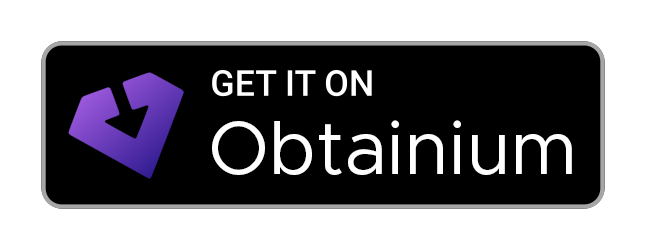
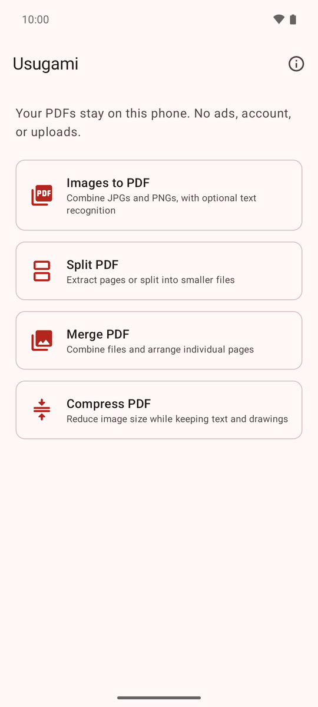
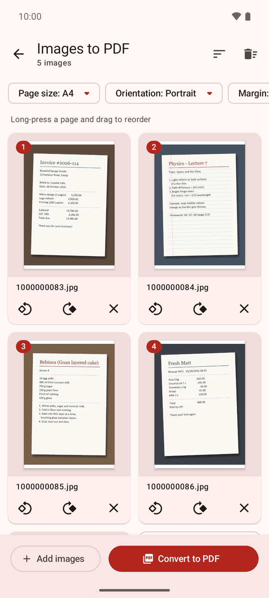
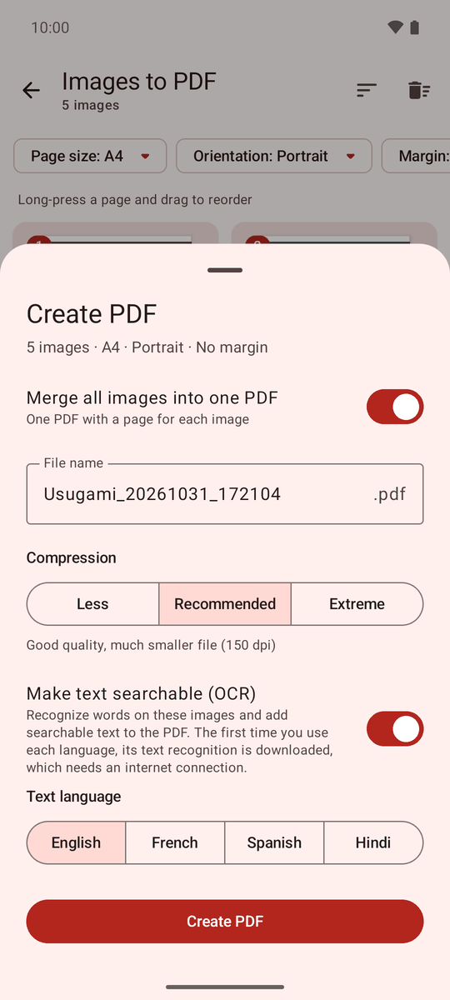
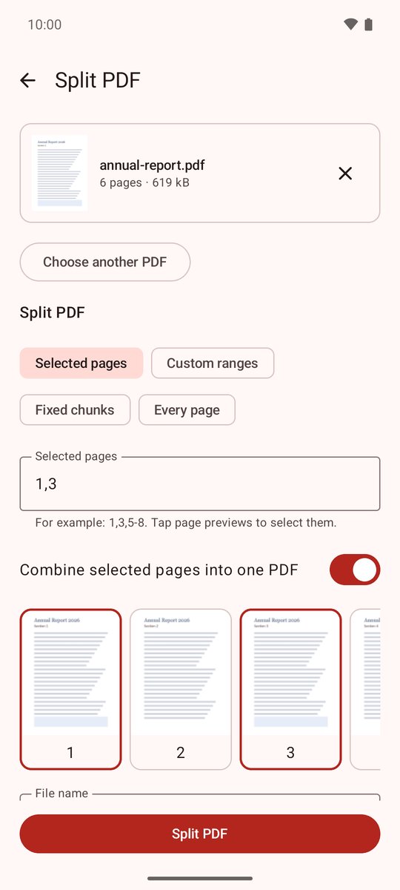

# Usugami

**Turn photos, Word documents, PowerPoint slides, Excel spreadsheets and EPUB e-books into PDFs,
and split, merge, reorganize, rotate, edit, number, watermark, sign, compress, flatten and redact
PDFs, right on your Android phone. No ads, no tracking, no account, no uploads.**

*Usugami* (薄紙, oo-soo-GAH-mee) is Japanese for "thin paper": a light app for making light PDFs.
It was called PDFer before version 1.2.0.

[](https://github.com/Nath-Goa/usugami/releases/latest)
[](LICENSE)
[](https://github.com/Nath-Goa/usugami/actions/workflows/ci.yml)


⭐ **Like Usugami?** Please star the repository. It's free
and helps other people find the app.

## Download

<a href="https://github.com/Nath-Goa/usugami/releases/latest/download/Usugami.apk"></a>
<a href="https://apps.obtainium.imranr.dev/redirect?r=obtainium://app/%7B%22id%22%3A%22io.github.nath_goa.usugami%22%2C%22url%22%3A%22https%3A%2F%2Fgithub.com%2FNath-Goa%2Fusugami%22%2C%22author%22%3A%22Nath-Goa%22%2C%22name%22%3A%22Usugami%22%2C%22additionalSettings%22%3A%22%7B%5C%22apkFilterRegEx%5C%22%3A%5C%22%5EUsugami%5C%5C%5C%5C.apk%24%5C%22%2C%5C%22autoApkFilterByArch%5C%22%3Afalse%2C%5C%22allowedSigningCertHashes%5C%22%3A%5C%226F%3A4F%3A23%3AAD%3AE0%3A3E%3A63%3A6A%3A7C%3AC3%3A68%3A16%3A89%3A44%3AD0%3ACC%3AFC%3A81%3A32%3AEF%3A34%3AC5%3A0B%3AC5%3AA4%3A6B%3A0C%3AA4%3ACB%3ABD%3AF4%3AED%5C%22%7D%22%7D"></a>

On your phone, tap **Get it on GitHub** to download **Usugami.apk** (about 3 MB), then follow the
[install steps](#install). Usugami comes in three editions, compared below; if you're not sure,
take this one.

Use Obtainium? Its badge adds Usugami with automatic updates. On Android 8.0 or 8.1,
[add it by hand](#automatic-updates-with-obtainium) instead.

| | **Usugami** (recommended) | **Usugami Lite** | **Usugami OCR** |
|---|---|---|---|
| Download | **[Usugami.apk](https://github.com/Nath-Goa/usugami/releases/latest/download/Usugami.apk)**, about 3 MB | **[Usugami-lite.apk](https://github.com/Nath-Goa/usugami/releases/latest/download/Usugami-lite.apk)**, about 2.8 MB | **[Usugami-ocr.apk](https://github.com/Nath-Goa/usugami/releases/latest/download/Usugami-ocr.apk)**, about 14 MB: the recognition engine and models are inside |
| Downloads | [](https://github.com/Nath-Goa/usugami/releases) | [](https://github.com/Nath-Goa/usugami/releases) | [](https://github.com/Nath-Goa/usugami/releases) |
| Images, Word, PowerPoint, Excel and EPUB to PDF, and every PDF tool | Fully offline | Fully offline | Fully offline |
| Text recognition (OCR) for searchable PDFs | Runs on your phone through Google Play services, which downloads Google's text-recognition model the first time you use it. | Not included | Open source and built into the app ([PaddleOCR](#how-usugami-ocr-reads-text) models). Works with no internet, forever. |
| Internet needed | Only for text recognition, the first time you use each language | Never | Never |
| Needs Google Play services | Only for text recognition | No | No |
| Google code inside | Google's ML Kit and Play services libraries, for text recognition | None | None |
| Works on | Android 8.0 or newer | Android 8.0 or newer | Android 8.0 or newer, ARM phones (virtually all phones) |
| Pick it if | You're not sure | You don't need text recognition and want the smallest app, with no Google code at all | Your phone has no Google services (for example Huawei or a de-Googled phone), or you want text recognition with no network use at all |

> [!NOTE]
> **About internet access:** Usugami itself has **no internet permission** and uploads nothing.
> The main **Usugami.apk** needs an internet connection **only for text recognition (OCR)**: the
> first time you use each language, Google Play services downloads its recognition model (and
> again if Play services has removed it since). Everything else works offline. If you want text
> recognition built in, with no download ever, get **[Usugami-ocr.apk](https://github.com/Nath-Goa/usugami/releases/latest/download/Usugami-ocr.apk)**
> instead. If you don't need text recognition at all, **[Usugami-lite.apk](https://github.com/Nath-Goa/usugami/releases/latest/download/Usugami-lite.apk)**
> is the smallest.

All three editions are signed with the same key. Usugami and Usugami OCR are the same app (package
name `io.github.nath_goa.usugami`), so you can switch between them at any time by installing one
over the other; your files and settings are kept. Usugami Lite is an app of its own
(`io.github.nath_goa.usugami.lite`, since version 1.5.1), so it installs next to them. Every
[release](https://github.com/Nath-Goa/usugami/releases) also has a `SHA256SUMS.txt` file for
[checking your download](#verify-your-download).

**F-Droid:** add Usugami's own F-Droid repository, easiest from **[nathank.me/usugami](https://nathank.me/usugami/)**
on your phone (one tap in F-Droid, Droid-ify or Neo Store), or by hand: address
`https://nathank.me/usugami/fdroid/repo`, fingerprint
`8D92FFB46DB5C052B334438D8E012974D3969A27EACFF4AEEE687B99A4760DA8`. It serves Usugami (with the
open-source text recognition of Usugami OCR) and Usugami Lite: exactly the APKs published here,
signed with the same key, so you can switch between F-Droid, GitHub and Obtainium without
reinstalling. A listing in the main F-Droid repository is planned; the builds are
[reproducible](https://f-droid.org/docs/Reproducible_Builds/) for that.

## What's new in 1.6.0

- **Scan document** at the top of Home: take photos with your phone's camera app, or upload images
  from your gallery
- **Two steps for each page:** crop it, now also by its sides and turned a quarter at a time, then
  choose its look, brightness and contrast
- **Seven looks**, with the new **Lighten**, **Super enhanced** and **Ink saver**, plus
  **Brightness** and **Contrast** sliders and **Apply to all pages**
- **Finds the page by its edges** too, so it can find a white page on a white desk, or one held in
  your hand
- **Excel to PDF:** .xlsx workbooks, each sheet on pages as Excel prints it, with its number and
  date formats, borders, merged cells, pictures, and headers and footers
- **Recent files** on Home: open, share or remove the files you saved, without searching through
  Downloads
- Still no permissions, not even for the camera, and nothing leaves your phone

1.5.2 and 1.5.3, just before: 40+ fixes from a full review of the app, safer redaction (links,
hidden form fields, Hebrew and Arabic), nothing lost when Android closes Usugami, and Usugami's own
[F-Droid repository](https://nathank.me/usugami/).

1.5.0, the big update before them:

- **Three editions:** Usugami, Usugami Lite (no Google code) and Usugami OCR (open-source text
  recognition built in)
- **Scan pages with your camera**, crop them straight, and make them black & white (tiny PDFs)
- **Batch mode:** compress, watermark, number or flatten many PDFs at once, and convert many Word,
  PowerPoint or EPUB files
- **Share PDFs, Word, PowerPoint and EPUB files** straight to Usugami
- **Text recognition reads your original photos**, so it's much more accurate
- **100+ bug fixes**

[Full changelog](CHANGELOG.md)

## Screenshots

<p>
  
  
  
  
</p>

## Install

Usugami isn't on the Play Store, so you install the APK file yourself. It takes about a minute and
works on Android 8.0 or newer. Menu names differ a little between phones.

1. **Download.** On your phone, open this page and tap **[Usugami.apk](https://github.com/Nath-Goa/usugami/releases/latest/download/Usugami.apk)**
   (or **[Usugami-lite.apk](https://github.com/Nath-Goa/usugami/releases/latest/download/Usugami-lite.apk)** or **[Usugami-ocr.apk](https://github.com/Nath-Goa/usugami/releases/latest/download/Usugami-ocr.apk)**).
   Your browser may warn that *this type of file can harm your device*. That's a general warning
   for all APK files; tap **Download anyway**.
2. **Open the file.** When the download finishes, tap **Open**. If you missed it, open the
   **Files** app (or **My Files** on Samsung), go to **Downloads** and tap the APK.
3. **Allow installing.** The first time, Android says something like *For your security, your
   phone currently isn't allowed to install unknown apps from this source*. Tap **Settings**,
   turn on **Allow from this source**, then go back. This permission is per app: it only lets the
   app you used (for example Chrome or Files) install apps.
4. **Install.** Tap **Install**.
5. **Google Play Protect.** Play Protect may say it hasn't seen this app before, or that it
   doesn't recognize the developer, and offer to **Scan app**. Scanning is safe: it sends details
   about the app to Google and then lets you install. If Play Protect ever says Usugami is
   *harmful*, don't install it; please [open an issue](https://github.com/Nath-Goa/usugami/issues)
   instead.
6. **Optional:** turn **Allow from this source** off again for that app.

Once it's installed, Usugami is also in other apps' **Share** menu: share images, PDFs, Word,
PowerPoint, Excel or EPUB files to it from Files, Photos, a mail app or a chat, and they open in the
right tool (see *Share to Usugami* under [Features](#features)).

<details>
<summary><b>Where is "Install unknown apps"? (Samsung and other phones)</b></summary>

If you skipped step 3 or want to change it later:

- **Samsung:** Settings → Apps → ⋮ (top right) → Special access → Install unknown apps → pick your
  browser or My Files → Allow from this source.
- **Pixel and most other phones:** Settings → Apps → Special app access → Install unknown apps →
  pick the app → Allow from this source.
- Or search for "unknown apps" in the Settings app.

</details>

**Updating:** download the new APK and install it over the old one, the same way. Your files and
settings are kept. To get updates automatically, use [Obtainium](#automatic-updates-with-obtainium).

**Switching editions:** install Usugami.apk over Usugami OCR, or Usugami-ocr.apk over Usugami. No
need to uninstall first. Usugami Lite is a separate app: install it next to the others, and
uninstall the one you no longer want (save any PDFs you need to Downloads first).

**Had Usugami Lite 1.5.0?** It was still the same app as Usugami. Since 1.5.1, Usugami Lite has a
package name of its own, so **[Usugami-lite.apk](https://github.com/Nath-Goa/usugami/releases/latest/download/Usugami-lite.apk)**
installs as a new app, "Usugami Lite", next to your old one, which is called "Usugami". Save any
PDFs you need from the old one, then uninstall it. If Obtainium updates it, remove it there and
[add Usugami Lite](#automatic-updates-with-obtainium) again: the old entry can't update to the new app.

**Had Usugami Offline?** Since version 1.5.0 it is Usugami OCR, with open-source text recognition
built in instead of Google's, and there is no Usugami-offline.apk any more. Install
**[Usugami-ocr.apk](https://github.com/Nath-Goa/usugami/releases/latest/download/Usugami-ocr.apk)**
over it: your files and settings are kept. If Obtainium updates it, change the app's APK filter
there to `^Usugami-ocr\.apk$`, or remove it from Obtainium and
[add Usugami OCR](#automatic-updates-with-obtainium) again; until then Obtainium finds no update.

**Had PDFer 1.0 or 1.1?** That was Usugami's old name. Those were private test builds with a
different package name, so Usugami installs as a separate app. Install Usugami, then uninstall the
old "PDFer".

## Features

**Scan document**

- The large card at the top of Home. **Take photo** opens your phone's own camera app; **Upload
  images** picks one or more images from your gallery. Usugami still asks for no permissions: the
  camera app saves just that photo for Usugami.
- Each page goes through two steps: **Crop page**, then **Filters** (both below). After a photo,
  **Take another** or **Done**. Uploaded images come one after another ("Page 2 of 5"), with
  **Next**, and **Done** on the last; close part way, and the images not cropped yet stay in the
  page list as they are.
- Then the pages are in Images to PDF, where you reorder them and make the PDF as usual.

**Images to PDF**

- Add JPG and PNG images from **Photos** (the system photo picker), **Files**, or by **sharing**
  them to Usugami from another app.
- **Take photo** scans more pages with your phone's own camera app, one after another, through the
  same two steps as Scan document.
- **Crop and straighten** any page, a photo just taken or any image you added (its crop button
  opens both steps): drag its four corners onto the page's corners, or a side by the handle in its
  middle (a magnifier shows what's under your finger, and buttons move a corner or side a step at a
  time), and the page comes out straight, as if scanned. **Rotate left** and **Rotate right** turn
  it a quarter at a time, on both steps. Usugami looks for the page by itself, as document scanners
  do: by how it stands out from the table, and by its edges and colours, so it can find even a white
  page on a white or light desk, a page on a brighter table or a pale coloured desk, or one held in
  a hand. **Reset** goes back to the page it found, **Whole image** keeps the whole picture, and the
  picture as added is kept, so a page can be cropped again from scratch.
- A **look** for each page, chosen on **Filters**, which shows the page large, as it will be in the
  PDF, and each look on the page itself: **Original**; **Lighten** (brighter, shadows softened, the
  colours kept close to the photo's); **Enhanced** (the paper made white, the lamp's colour and
  shadows taken out, the print darker); **Super enhanced** (whiter paper, darker and sharper print,
  richer colours); **Grayscale**; **Black & white**, which keeps print crisp and turns the paper
  white, in a shadow too; and **Ink saver**, black and white that leaves large dark areas hollow, to
  save ink or toner. **Brightness** and **Contrast** sliders change any look.
- **Apply to all pages** gives every page the look, brightness and contrast. Every new scan starts
  on Enhanced; after that, each photo taken or image uploaded starts on the look chosen last.
- Black-and-white and Ink saver pages are stored one bit a pixel (CCITT Group 4, as scanners store
  pages), so a page of print takes about 10 KB instead of the 50 to 350 KB of a photo; grayscale
  pages are stored in grey.
- Live page previews. Long-press and drag to **reorder**; **rotate**, **remove**, or **sort** by
  name or reverse the order.
- Page size **Fit** (same as the image), **A4**, **US Letter**, **US Legal**, **A3** or **A5**;
  orientation Auto, Portrait or Landscape; no margin, a small one or a big one.
- Make **one PDF** with every image, or **one PDF per image**.
- **Always compressed:** each image is sized for the space it fills on the page and saved as JPEG
  (black-and-white pages one bit a pixel) at **Less** (200 dpi), **Recommended** (150 dpi) or
  **Extreme** (100 dpi). If the original image is smaller, the original is kept.
- Phone photos come out the **right way up** (EXIF orientation).
- **Private by default:** location (GPS), camera details and other hidden metadata, and the video
  part of "motion photos", are removed from the images.
- Optional **searchable PDF** with text recognition (OCR) in **English**, **French**,
  **Spanish** or **Hindi**. Hindi mode also keeps any English text. Text is read from your
  original images (cropped pages as cropped, in colour whatever their look), not the compressed
  copies, so small print is found even at Extreme. (In Usugami and Usugami OCR; Usugami Lite has
  no text recognition.)

**Word to PDF**

- Turns **.docx** documents into PDFs on your phone. Nothing is uploaded. Pick them, or share them
  to Usugami from another app.
- Keeps the page size and margins, headings and other styles, bold, italic, underlined, colored and
  highlighted text, bulleted and numbered lists, tables (split across pages, with their header row
  repeated), pictures, page breaks, landscape pages, and headers and footers with page numbers.
- The text stays real text, so you can search and select it in the PDF.
- Pictures are compressed as in Compress PDF (Recommended), and only the letters the document uses
  of your phone's fonts go into the PDF, so it stays small.
- **Several at once:** pick several documents, or add more later, for one PDF of each, each named
  as you like.

**PowerPoint to PDF**

- Turns **.pptx** presentations into PDFs: one page per slide, in order, the size of the slides.
  Hidden slides are left out. Pick them, or share them to Usugami from another app.
- Keeps backgrounds, text and bullets in the presentation's own styles, shapes, pictures and tables.
  Text too long for its box is shrunk to fit, as PowerPoint does.
- Pictures are compressed, and only the letters the slides use of your phone's fonts go into the
  PDF, so it stays small.
- Some things are simplified: see *What converts from Word and PowerPoint?* under
  [Questions and troubleshooting](#questions-and-troubleshooting).
- **Several at once:** pick several presentations for one PDF of each, each named as you like.

**Excel to PDF**

- Turns **.xlsx** workbooks into PDFs on your phone, each visible sheet on pages as Excel prints it.
  Pick them, or share them to Usugami from another app.
- Follows each sheet's print setup: its print area (or everything from A1), title rows and columns
  repeated on every page, page breaks, paper size, orientation, margins, scale and Fit to. Pages
  are numbered through the whole workbook, and pages with nothing on them are left out.
- Cells show their numbers, currencies, percentages, fractions, dates and times as Excel shows
  them, red negatives included, with their fonts, colors, fills, borders, alignment, wrapped and
  merged cells, column widths and row heights. Pictures, headers and footers come along; hidden
  sheets, rows and columns are left out.
- **Page size** and **Orientation** stay as each sheet was set to print (US Letter when a sheet
  names no paper), or choose one for every sheet. **Fit columns to page width** (on at first)
  shrinks a wide sheet so its columns fit across the page, but never below half size; a sheet set
  to fit its own way keeps that. **Gridlines** (off at first, as in Excel) adds light gray lines on
  the sheets that show them on screen; a sheet set to print its gridlines always gets them.
- The text stays real text, so you can search and select it in the PDF.
- Some things are left out or simplified: see *What converts from an Excel workbook?* under
  [Questions and troubleshooting](#questions-and-troubleshooting).
- **Several at once:** pick several workbooks for one PDF of each, each named as you like.

**EPUB to PDF**

- Turns **.epub** e-books into PDFs on your phone, on **A5** pages (about the size of a paperback)
  or **A4** for printing. Pick them, or share them to Usugami from another app.
- The cover comes first, then the chapters in the book's reading order, each on a new page.
- Keeps headings, paragraphs, bold, italic and underlined text, lists, quotes, simple tables and
  pictures, and the simple parts of the book's style: alignment, indents, spacing, font sizes and
  page breaks.
- The table of contents becomes the PDF's **bookmarks**, and the book's title and author go into
  the PDF.
- Pictures are compressed, and only the letters the book uses of your phone's fonts go into the
  PDF, so it stays small.
- Books with DRM (copy protection) can't be converted: see *What converts from an EPUB e-book?*
  under [Questions and troubleshooting](#questions-and-troubleshooting).
- **Several at once:** pick several books for one PDF of each, all on the page size you choose, each
  named as you like.

**Split PDF**

- Pick pages by tapping previews or typing numbers like `1,3,5-8`.
- Enter separate ranges like `1-3;5;7-9`, split into chunks of a fixed size, or make one PDF per
  page.
- Combine the selection into one PDF, or save each part as its own file.

**Merge PDF**

- Add PDFs and put them in order, or sort them by name.
- Switch to page mode to reorder, rotate and remove individual pages before merging.

**Reorganize PDF**

- See a PDF's pages in a grid. Tap a page to choose it, then move it earlier or later, turn it or
  remove it with the buttons above the grid; or long-press a page and drag it.
- **Add pages** after the chosen page (or at the end): the pages of another PDF, which you can then
  arrange like the rest, or a blank page the size of the page before it.
- **Undo** takes back one change at a time.
- The bookmarks, links and form fields of the pages you keep stay as they were.

**Delete pages**

- Tap the pages to delete, or type them like `2,5-7`; Usugami shows how many will go. A PDF keeps
  at least one page.
- Deleted pages are really gone: their text, pictures, form fields and bookmarks aren't left
  hidden in the file. (This is also true of the pages you remove in Reorganize PDF and Merge PDF.)

**Compress PDF**

- **Less**, **Recommended** or **Extreme**.
- Text stays selectable and drawings stay sharp; only images are reduced.
- Never makes a PDF bigger: if compressing can't save space, you keep the original. (Except
  for password-protected PDFs, which are always saved again without the password.)
- **Many PDFs at once:** pick several, then add more or remove one at any time. Set the level for
  all of them in one go, or give a PDF a level of its own, and name each new PDF as you like.
  They're compressed one after another; if one can't be read, Usugami names it and still makes the
  others.
- Each new PDF says how much smaller it got, or that its original was kept, and has its own
  **Open**, **Share** and **Save** buttons. **Save to Downloads** and **Save to folder…** save
  them all, each as its own file.

**Flatten PDF**

- Makes filled-in form fields, comments, highlights, drawings and stamps part of the page, so
  nothing can be changed or filled in any more, and every PDF viewer shows them the same way.
- A field whose text the form's own font can't show (Hindi typed into a form made for English,
  say) and that no app has drawn yet stays a field instead of losing its text, and Usugami tells you.
- Links keep working.
- If a PDF has nothing to flatten, Usugami tells you instead of saving a copy.
- **Many PDFs at once:** each is flattened into a PDF of its own, named as you like. One with
  nothing to flatten is left out, and Usugami names it.

**Rotate PDF**

- Turn single pages left or right, or all of them at once, and watch them turn.
- Only the way each page is shown changes: text, images and quality stay exactly as they were.

**Add page numbers**

- At the top or bottom, on the left, in the center or on the right; small, medium or large.
- Skip pages, such as a cover (`1`) or `1-2,5`. Each page keeps its own number, so after a skipped
  cover the next page is numbered 2.
- Numbers go where you see the bottom (or top) of the page, even on pages turned sideways.
- **Many PDFs at once:** each is numbered the same way, into a PDF of its own named as you like.
  Pages to skip are skipped in each PDF that has them; a PDF with every page skipped is left out,
  and Usugami says so.

**Add watermark**

- Write any text, such as DRAFT or CONFIDENTIAL, large and diagonally across every page.
- Gray, black, red, blue or green; translucent, semi-opaque or opaque. A preview shows the first
  page with the watermark.
- Works in any language your phone has fonts for, accents and Hindi included. The watermark is
  real text, not a picture.
- **Many PDFs at once:** the same watermark goes on each (the preview shows the first), each into a
  PDF of its own named as you like.

**Edit PDF**

- Add **text**, **drawings** with your finger, **highlights**, **shapes** (rectangles, filled or
  not, ellipses, lines and arrows) and **pictures** from your phone on top of any page.
- Each goes in the middle of the page, ready to drag into place, resize with its handles or the
  size slider, or move a step at a time with arrow buttons. Six colors, and a thickness for lines.
- Tap something you added to change or delete it. **Undo** and **Redo** take back or redo one
  change at a time.
- Everything lands exactly where the preview shows it, also on pages turned sideways or cropped.
  Text stays real, searchable text in any language your phone has fonts for, Hindi included;
  drawings and shapes stay sharp at any zoom; photos are compressed. Pages you don't change are left
  exactly as they were.
- It adds to the page; it doesn't change the text already there. A filled box only hides what's
  under it: see *Can Edit PDF change or remove the text already in a PDF?* under
  [Questions and troubleshooting](#questions-and-troubleshooting).

**Sign PDF**

- Draw your signature with a finger, in black or blue ink.
- Pick the page, then drag the signature into place on a preview of it and choose its size. Arrow
  buttons move it a step at a time, too.
- It goes on the page as a sharp picture with a see-through background, exactly where the preview
  shows it, also on pages turned sideways or cropped.
- Usugami keeps your signature only while it is open, so you can sign another PDF without drawing
  it again. It isn't saved anywhere else.
- It's a picture of your handwritten signature, not a certified digital signature.

**Redact PDF**

- Black out names, numbers or anything else for good. Drag on a page to draw a box over it, or type
  a word or phrase in **Find text** to box it on every page (capitals and accents don't matter).
- Check the boxes before saving: they're see-through on the screen, and solid black in the PDF.
  Tap a box to move, resize or delete it, also with buttons, or add one with **Add box**.
- **True removal, not a black box on top:** each page with a box is saved as a picture of itself
  with the boxes painted in, so what was under them is no longer in the file at all. Pages without
  boxes stay exactly as they were, unless they keep part of what a box hides out of sight.
- Also removes what could give the hidden text away elsewhere in the file: the title, author and
  other document details, bookmarks, accessibility tags, attached files, scripts, and the comments
  and form fields of the redacted pages.
- Redacted pages are pictures at 200 dpi, sharp enough for small print, so their text can't be
  selected or searched any more. See *How does Redact PDF work?* under
  [Questions and troubleshooting](#questions-and-troubleshooting).

**Everywhere**

- Home starts with **Scan document** and, once you've saved a file, **Recent files**, then groups
  the tools under **Create PDF**, **Organize**, **Edit and sign** and **Optimize and protect**.
- **Search** on Home finds a tool as you type, by its name, what it does or a word you
  might use for it ("combine", "shrink", "scan"), in the app's language. Case and accents don't
  matter. "Batch", "many" or "several" finds the tools that work on several files at once.
- **Several files at once:** Compress PDF, Add page numbers, Add watermark, Flatten PDF, and Word,
  PowerPoint, Excel and EPUB to PDF take several files: the same choices for all of them (Compress
  PDF can also give one a level of its own), a name of your own for each new PDF, and a PDF of each,
  made one after another with "PDF 2 of 5" and the file's name in the progress. If one can't be
  made, Usugami names it, says why, and still makes the others. One file works just as before.
- **Share to Usugami** from another app (Files, a mail app, a chat): images open Images to PDF,
  Word, PowerPoint, Excel and EPUB files their converter, and PDFs **Choose a tool**, which lists
  every PDF tool for one PDF, and Merge PDF and the tools for several files for more. The tool you
  choose opens with them in it, and goes back to Choose a tool when you leave it. They're copied in
  at once, so they're still there if Android stops Usugami in the background (if it stops Usugami
  while they're still being copied in, Usugami tells you to share them again).
- Shared together, files of different kinds: Usugami takes the kind most of them are (PDFs first
  when it's a tie) and names the files it left out, and those it can't open. If a tool has work you
  haven't saved, Usugami asks first; while a PDF is being made, the shared files wait for it. Images
  shared while Choose a tool, a tool opened from it, or the converter shared files opened shows wait
  in Images to PDF until you leave.
- Password-protected PDFs can be opened with their password. The new files Usugami makes from them
  have no password, and Usugami tells you so.
- **Open**, **Share**, **Save to Downloads** (Android 10 and newer) or **Save as…** to any
  folder. When a PDF tool makes several PDFs, each one also has its own **Open**, **Share** and
  **Save**.
- When a tool makes several PDFs (Split PDF in parts, a tool working on several files, or one PDF
  per image), **Share or save as ZIP** puts them all in one ZIP file, named after them, to share
  or save in one go.
- **Recent files** lists the files you save from any tool, newest first: the last three on Home,
  and all of them (up to 50) under **See all**. Tap one to open it, or use its menu to **Share** it
  or **Remove from list**; **Clear list** empties the list. The files themselves stay where you
  saved them. A file you delete in another app leaves the list by itself, and one renamed in
  Downloads shows its new name. Files you only share aren't listed.
- Comes in **English**, **French**, **Spanish** and **Hindi**: pick one the first time you open
  Usugami, and change it any time in **Settings**. Text recognition starts on the same language.
- Light and dark theme follow your phone, or pick **Light** or **Dark** in **Settings** →
  **Appearance**.

## Privacy

- **No internet permission.** Android doesn't let Usugami connect to the internet, so it can't
  upload your files.
- **No ads, no analytics, no tracking, no accounts, no in-app purchases.**
- **Only the files you pick.** Usugami asks for no permissions; Android gives it access to just the
  images, PDFs and documents you choose or share. **Take photo** opens your phone's camera app,
  which Usugami lets save just that one photo into its private storage; Usugami can't use the
  camera itself.
- **Temporary copies are cleaned up.** While you work, copies live in Usugami's private cache and
  are deleted automatically.
- **Recent files stays on your phone.** To open the files on the list again, Usugami keeps read
  access only to them (at most 50) and to a folder you saved into while one of its files is listed,
  and gives it back once they leave the list. It can always read what it saved to Downloads.
- **Usugami (the main edition) and Google Play services:** text recognition runs on your phone,
  through Google Play services (a separate Google app), which downloads the model for each
  language the first time you use it. For this, Google's libraries inside Usugami talk to Play services on your
  phone, and Play services may report to Google how these Google APIs were used, along with
  diagnostics and usage metrics about ML Kit (see
  [Google's ML Kit data disclosure](https://developers.google.com/ml-kit/android-data-disclosure)).
  Your images and the recognized text are not part of this and never leave your phone. Usugami
  also disables ML Kit's own metrics uploader inside the app.
- **Usugami Lite and Usugami OCR** contain no Google code, don't need Google Play services and
  make no network connections. Usugami OCR has text recognition built in; Usugami Lite has none.

Read the full [privacy policy](PRIVACY.md). It's also inside the app.

## Verify your download

You don't have to do this, but you can check that an APK really comes from this project. The
signing certificate is what matters: Android only installs updates signed with the same
certificate, and only the developer has the key.

| | |
|---|---|
| Package name | `io.github.nath_goa.usugami` (Usugami and Usugami OCR) or `io.github.nath_goa.usugami.lite` (Usugami Lite) |
| Signing certificate SHA-256 | `6F:4F:23:AD:E0:3E:63:6A:7C:C3:68:16:89:44:D0:CC:FC:81:32:EF:34:C5:0B:C5:A4:6B:0C:A4:CB:BD:F4:ED` |

- **On your phone (Android 9 or newer):** install
  [AppVerifier](https://github.com/soupslurpr/AppVerifier), then paste these two lines into it
  after installing Usugami or Usugami OCR (for Usugami Lite, the first line is
  `io.github.nath_goa.usugami.lite`):

  ```text
  io.github.nath_goa.usugami
  6F:4F:23:AD:E0:3E:63:6A:7C:C3:68:16:89:44:D0:CC:FC:81:32:EF:34:C5:0B:C5:A4:6B:0C:A4:CB:BD:F4:ED
  ```

  AppVerifier doesn't run on Android 8.0 or 8.1; use a computer (below) instead.

<details>
<summary><b>On a computer: apksigner, checksums and build provenance</b></summary>

**Signing certificate** with `apksigner` from the Android SDK build-tools:

```sh
apksigner verify --print-certs Usugami.apk
```

The `certificate SHA-256 digest` line must read
`6f4f23ade03e636a7cc368168944d0ccfc8132ef34c50bc5a46b0ca4cbbdf4ed`. The `certificate DN` line
says `CN=Nathan Kumtakar, O=Usugami`, but anyone can put any name in a certificate, so only the
digest proves who signed the APK. (`keytool -printcert -jarfile` doesn't work here: Usugami uses
the newer APK signature schemes, which keytool can't read.)

**Checksums:** download `SHA256SUMS.txt` from the same release, put it next to the APK you
downloaded and run:

```sh
sha256sum -c --ignore-missing SHA256SUMS.txt          # Linux
shasum -a 256 -c --ignore-missing SHA256SUMS.txt      # macOS
Get-FileHash Usugami.apk -Algorithm SHA256            # Windows PowerShell: compare with the file
```

Your APK must show `OK`. (`SHA256SUMS.txt` lists all three editions; `--ignore-missing` skips the
ones you didn't download.)

GitHub also shows each file's SHA-256 next to it on the release page.

**Build provenance:** release APKs are built from this repository's source by the
[release workflow](.github/workflows/release.yml) on GitHub Actions, which publishes a signed
build-provenance attestation for each one. Check it with the [GitHub CLI](https://cli.github.com/):

```sh
gh attestation verify Usugami.apk --repo Nath-Goa/usugami
```

</details>

## Automatic updates with Obtainium

[Obtainium](https://github.com/ImranR98/Obtainium) is a free app that installs and updates apps
straight from their GitHub releases. These links add Usugami to Obtainium with the right file and
the signing certificate already set, so Obtainium refuses any APK that wasn't signed with Usugami's
key:

- [Add **Usugami** to Obtainium](https://apps.obtainium.imranr.dev/redirect?r=obtainium://app/%7B%22id%22%3A%22io.github.nath_goa.usugami%22%2C%22url%22%3A%22https%3A%2F%2Fgithub.com%2FNath-Goa%2Fusugami%22%2C%22author%22%3A%22Nath-Goa%22%2C%22name%22%3A%22Usugami%22%2C%22additionalSettings%22%3A%22%7B%5C%22apkFilterRegEx%5C%22%3A%5C%22%5EUsugami%5C%5C%5C%5C.apk%24%5C%22%2C%5C%22autoApkFilterByArch%5C%22%3Afalse%2C%5C%22allowedSigningCertHashes%5C%22%3A%5C%226F%3A4F%3A23%3AAD%3AE0%3A3E%3A63%3A6A%3A7C%3AC3%3A68%3A16%3A89%3A44%3AD0%3ACC%3AFC%3A81%3A32%3AEF%3A34%3AC5%3A0B%3AC5%3AA4%3A6B%3A0C%3AA4%3ACB%3ABD%3AF4%3AED%5C%22%7D%22%7D) (the main edition)
- [Add **Usugami Lite** to Obtainium](https://apps.obtainium.imranr.dev/redirect?r=obtainium://app/%7B%22id%22%3A%22io.github.nath_goa.usugami.lite%22%2C%22url%22%3A%22https%3A%2F%2Fgithub.com%2FNath-Goa%2Fusugami%22%2C%22author%22%3A%22Nath-Goa%22%2C%22name%22%3A%22Usugami%20Lite%22%2C%22additionalSettings%22%3A%22%7B%5C%22apkFilterRegEx%5C%22%3A%5C%22%5EUsugami-lite%5C%5C%5C%5C.apk%24%5C%22%2C%5C%22autoApkFilterByArch%5C%22%3Afalse%2C%5C%22allowedSigningCertHashes%5C%22%3A%5C%226F%3A4F%3A23%3AAD%3AE0%3A3E%3A63%3A6A%3A7C%3AC3%3A68%3A16%3A89%3A44%3AD0%3ACC%3AFC%3A81%3A32%3AEF%3A34%3AC5%3A0B%3AC5%3AA4%3A6B%3A0C%3AA4%3ACB%3ABD%3AF4%3AED%5C%22%7D%22%7D)
- [Add **Usugami OCR** to Obtainium](https://apps.obtainium.imranr.dev/redirect?r=obtainium://app/%7B%22id%22%3A%22io.github.nath_goa.usugami%22%2C%22url%22%3A%22https%3A%2F%2Fgithub.com%2FNath-Goa%2Fusugami%22%2C%22author%22%3A%22Nath-Goa%22%2C%22name%22%3A%22Usugami%20OCR%22%2C%22additionalSettings%22%3A%22%7B%5C%22apkFilterRegEx%5C%22%3A%5C%22%5EUsugami-ocr%5C%5C%5C%5C.apk%24%5C%22%2C%5C%22autoApkFilterByArch%5C%22%3Afalse%2C%5C%22allowedSigningCertHashes%5C%22%3A%5C%226F%3A4F%3A23%3AAD%3AE0%3A3E%3A63%3A6A%3A7C%3AC3%3A68%3A16%3A89%3A44%3AD0%3ACC%3AFC%3A81%3A32%3AEF%3A34%3AC5%3A0B%3AC5%3AA4%3A6B%3A0C%3AA4%3ACB%3ABD%3AF4%3AED%5C%22%7D%22%7D)

Open the link on your phone with Obtainium installed, and confirm. Usugami and Usugami OCR share a
package name, so add only one of those two; Usugami Lite is an app of its own and can be added next
to either. (Added Usugami Lite before version 1.5.1? Remove it and add it again with its link
above, which has its new package name.)

On Android 8.0 and 8.1, Obtainium can't read signing certificates, so it refuses to install an
app that has a certificate set. On those versions, add Usugami by hand (below) and leave the
certificate field empty.

<details>
<summary><b>Adding it by hand</b></summary>

In Obtainium, tap **Add app**, enter `https://github.com/Nath-Goa/usugami` as the app source URL,
and set:

- **Filter links by regex:** `^Usugami\.apk$` (or `^Usugami-lite\.apk$` for Usugami Lite,
  `^Usugami-ocr\.apk$` for Usugami OCR)
- **Expected signing certificate hashes:** the SHA-256 fingerprint from
  [Verify your download](#verify-your-download) (leave empty on Android 8.0 and 8.1)

Setting names can differ slightly between Obtainium versions.

</details>

## Questions and troubleshooting

Can't find your answer below? Ask in [Discussions](https://github.com/Nath-Goa/usugami/discussions/categories/q-a)
(questions and [ideas](https://github.com/Nath-Goa/usugami/discussions/categories/ideas) are welcome there), or
[open an issue](https://github.com/Nath-Goa/usugami/issues) if something is broken.

<details>
<summary><b>"App not installed" or "the package conflicts with an existing package"</b></summary>

- **A Usugami from somewhere else is installed.** Android only updates an app with an APK signed by
  the same key. If you got Usugami from another site, uninstall it first (save any PDFs you need to
  Downloads before you do), then install the APK from this page.
- **You're installing an older version** over a newer one. Android doesn't allow that; download
  the [latest release](https://github.com/Nath-Goa/usugami/releases/latest).
- **The download is incomplete or the phone is low on storage.** Free some space, download the APK
  again and try once more.
- The old PDFer 1.0 and 1.1 test builds don't conflict: they have a different package name and
  install side by side.

</details>

<details>
<summary><b>My phone doesn't have Google Play services</b></summary>

For example Huawei phones, or phones running LineageOS or /e/OS without Google apps. Images to
PDF and all the PDF tools work in every edition. Text recognition in the main edition
(Usugami.apk) needs Google Play services; without it, Usugami tells you that text recognition
isn't available, and you can still create the PDF with OCR turned off.

For text recognition on such a phone, install
**[Usugami-ocr.apk](https://github.com/Nath-Goa/usugami/releases/latest/download/Usugami-ocr.apk)**
over your current Usugami: it has text recognition built in.

</details>

<details>
<summary><b>Text recognition is stuck downloading, or I have no internet</b></summary>

In Usugami (the main edition), Google Play services downloads text recognition the first time
you use each language (English, French and Spanish share one download; Hindi is a second one),
and again if it has removed it since.
If it doesn't finish:

- Check that you have a working Wi-Fi or mobile data connection.
- Make sure the phone has some free storage.
- Update Google Play services: open the Play Store, search for "Google Play services" and update
  it if you can.
- Try again in a few minutes. Your images stay in Usugami, and you can also create the PDF with OCR
  turned off.

Going somewhere without internet? Run text recognition once in each language you need while you're
still online.

If you often have no internet, or want no download at all, install
**[Usugami OCR](https://github.com/Nath-Goa/usugami/releases/latest/download/Usugami-ocr.apk)**
over your current Usugami.

</details>

<details>
<summary><b>Recognizing French, Spanish or Hindi text</b></summary>

When you create the PDF, turn on **Make text searchable (OCR)** and choose the text language:
English, French, Spanish or Hindi. It starts on the language you picked for the app. French and
Spanish keep their accents (é, ç, ñ). Hindi mode reads Devanagari and also keeps English words and
numbers, so mixed text works.

In Usugami (the main edition), English, French and Spanish use one model and Hindi another, so the
first recognition with each of those needs an internet connection. Usugami Lite has no text
recognition.

</details>

<details>
<summary><b>How Usugami OCR reads text</b></summary>

<a id="how-usugami-ocr-reads-text"></a>
Usugami OCR has its own text recognition, open source and inside the app: the
[PaddleOCR](https://github.com/PaddlePaddle/PaddleOCR) PP-OCRv5 mobile models, run on your phone's
processor by Tencent's [ncnn](https://github.com/Tencent/ncnn). One model finds the lines of text
on each page; then English, French and Spanish are read by PaddleOCR's Latin-script model, and
Hindi by its Devanagari model, which also reads English words. Nothing is downloaded and nothing
leaves your phone, so it works in flight mode too. The engine and models are what make
Usugami-ocr.apk about 11 MB bigger than Usugami.apk.

- It reads printed text best: worksheets, letters, book pages, notices, including photos taken at an
  angle. Columns are read one after the other.
- A page photographed upside down or sideways is read the right way up.
- Handwriting, very small or blurred print, tables and maths are read less reliably. A sharp,
  well-lit photo taken straight on helps the most.
- Each page takes a few seconds, longer on older phones. You can cancel at any time.
- Its results differ from Google's text recognition in the main edition: sometimes better, sometimes
  worse.

</details>

<details>
<summary><b>What converts from Word and PowerPoint?</b></summary>

Usugami reads the file itself, on your phone, and lays it out again. The PDF is close to the
original, but not always identical:

- **Converts:** text and its formatting, headings and other styles, lists, tables, pictures, page
  and slide sizes, slide backgrounds and shapes, and headers and footers.
- **Simplified:** your phone's fonts stand in for the document's (such as Calibri or Times New
  Roman), so lines can break in slightly different places. Text doesn't wrap around floating
  pictures, and several columns become one. Charts become gray boxes with their title, and so does
  SmartArt in Word documents. Shadows, 3-D effects, animations and videos are left out, as are
  comments, footnotes and speaker notes.
- **Not converted:** old **.doc** and **.ppt** files (save them as .docx or .pptx in Word,
  PowerPoint or another office app first), and password-protected files (remove the password
  first). Excel workbooks have a tool of their own: see *What converts from an Excel workbook?*
- The text in the PDF is real text you can search and copy. In Hindi and other scripts with joined
  letters, copied text can come out jumbled, even though it looks right on the page.

</details>

<details>
<summary><b>What converts from an Excel workbook?</b></summary>

Usugami reads the workbook itself, on your phone, and lays out each sheet as Excel prints it:

- **Converts:** every visible sheet with something on it, each starting a new page; cell values as
  their number formats show them (dates, times, currencies, percentages, fractions, red
  negatives); fonts, colors, fills, borders, alignment, wrapped, shrunk and turned text, and merged
  cells; column widths and row heights; pictures placed on the sheet; and the print setup: print
  area, title rows and columns, page breaks, paper size, orientation, margins, scale, Fit to, and
  headers and footers with page numbers, dates and sheet names.
- **Simplified:** your phone's fonts stand in for the workbook's, at the same widths, so text can
  wrap a little differently and a number right at its column's width may show as ####. Patterned
  and gradient fills become one color, and an accounting format's currency sign sits next to the
  number instead of at the cell's left edge. Right-to-left sheets aren't mirrored.
- **Left out:** charts, shapes and text boxes, comments, conditional formatting (the values a data
  bar hides stay hidden), table styles, sparklines and pictures in headers.
- **Formulas aren't recalculated:** each cell shows the value the file saved. A formula the file
  kept no value for (a few apps save formulas without one) shows itself, such as `=A2*2`.
- **Not converted:** old **.xls** files (save them as .xlsx in Excel or another app first),
  password-protected workbooks (remove the password first), and workbooks that would make more
  than 5,000 pages (set a print area for the part you need).
- The text in the PDF is real text you can search and copy. In Hindi and other scripts with joined
  letters, copied text can come out jumbled, even though it looks right on the page.

</details>

<details>
<summary><b>What does Flatten PDF do with XFA forms and signed PDFs?</b></summary>

- **XFA forms**: some forms, often from government offices, are made with Adobe's XFA format,
  which only some PDF apps can show. Usugami can't read the XFA part, so it removes it and
  flattens the ordinary form fields the PDF also has, and tells you so. If the form is XFA only,
  Usugami says it can't flatten it and makes no file.
- **Digitally signed PDFs**: changing a signed PDF in any way, flattening included, breaks its
  digital signature. Keep the original if the signature matters.

</details>

<details>
<summary><b>What converts from an EPUB e-book?</b></summary>

Usugami reads the book itself and lays its pages out again, as an e-reader does:

- **Converts:** EPUB 2 and EPUB 3 books: the cover, the chapters in reading order, headings,
  paragraphs and line breaks, bold, italic, underlined and struck-through text, lists, quotes,
  simple tables, pictures, and the table of contents as bookmarks. From the book's style sheet:
  alignment, indents, spacing, font sizes, hidden parts and page breaks.
- **Simplified:** your phone's serif, sans-serif or monospace font stands in for the book's own
  fonts. Colors, backgrounds, borders, floating pictures and columns are left out, and links stay as
  plain text. Footnotes stay where the book puts them. SVG drawings are left out (their description
  is shown, if they have one).
- **Fixed-layout books**, such as comics and picture books, get one PDF page per page of the book,
  as best Usugami can: a page that is a single picture fills the PDF page, and anything else is
  laid out in order and shrunk to fit, so text the book places over a picture comes after it.
- **Not converted:** books protected with DRM (copy protection), as many bought from online stores
  are. Usugami can't remove DRM; books without it, such as free public-domain books, convert fine.
  Kindle files (.mobi, .azw) aren't EPUB books.
- The text in the PDF is real text you can search and copy. In Hindi and other scripts with joined
  letters, copied text can come out jumbled, even though it looks right on the page.

</details>

<details>
<summary><b>Can Edit PDF change or remove the text already in a PDF?</b></summary>

No. Edit PDF adds text, drawings, shapes and pictures on top of the page; the PDF's own text stays
as it was. You can cover something with a filled rectangle (white, say) and write over it, but the
covered text is still in the file: anyone can select, copy or search it, or remove the rectangle in
another app. To remove text or pictures for good, use Redact PDF instead.

</details>

<details>
<summary><b>How does Redact PDF work?</b></summary>

Covering text with a black shape isn't enough: the text is still in the PDF underneath, and anyone
can copy it out. So Usugami saves each page that has a box as a picture of the page, with the boxes
painted solid black into the picture. What was under a box is gone from the file, and so is the
text of the rest of that page (it is still there to read, as a picture).

- **Pages without boxes** stay as they were, with their text, links and form fields. Only a page
  that keeps, out of sight, part of what a box hides becomes a picture too, of what it shows: say,
  two pages cut from one scanned spread, each still holding the whole scan.
- **Pages with boxes** become pictures at 200 dpi. Their text can't be selected, searched or read
  aloud any more, links on them stop working, and their comments and form fields become part of
  the picture. The PDF usually gets bigger: each redacted page takes a few hundred KB.
- **Also removed:** the document's title, author and other details (and its XMP metadata),
  bookmarks, accessibility tags, attached files, JavaScript, application data some apps hide in
  PDFs, form fields that were only on redacted pages, and images that only redacted pages showed.
- **Find text** finds text the PDF stores as text, and what comments say (a comment that has it
  gets a box over it, only a small one at the corner of a highlight or drawing, so it goes with its
  page). It can't find words in scans or photos (draw boxes over those yourself), and it may miss
  text in PDFs whose text doesn't copy out correctly, such as some PDFs in Hindi and other scripts
  with joined letters. Always look through the pages before you save.
- A digital (certificate) signature in the PDF no longer matches once anything is redacted, so
  what it says of the signer (name, reason, certificate) is removed too.

</details>

<details>
<summary><b>Where are my PDFs saved?</b></summary>

Nowhere until you choose. When a PDF is ready you can:

- **Save to Downloads** (Android 10 and newer): it appears in the Downloads folder of your Files app.
- **Save as…**: choose any folder, on any Android version.
- **Share** it to another app, or **Open** it in a PDF viewer.

Several PDFs at once (from Split PDF, or one PDF per image) can also go into one **ZIP** file, to
share or save with **Share or save as ZIP**. The PDFs go in exactly as they are.

Until you save or share it, the PDF stays in Usugami's private storage and is cleaned up
automatically. Every file you save also shows under **Recent files** on Home, to open or share
again.

</details>

<details>
<summary><b>How much storage does Usugami use?</b></summary>

The app takes about 3 MB to download (Usugami OCR about 14 MB, since its recognition engine and
models are inside).
While you work, Usugami keeps temporary copies of your files in its cache and deletes them
automatically; you can also clear it in Settings → Apps → Usugami → Storage. In the main edition,
the text-recognition models are stored and managed by Google Play services, not by Usugami.

</details>

<details>
<summary><b>Will Android's new developer verification stop me installing Usugami?</b></summary>

Google has announced that Android will check that apps come from verified developers. As of
October 2026 these checks don't apply to apps downloaded from GitHub, so you can install Usugami as
described above. Google has said it plans to extend the checks to all countries in 2027. If that
changes how you install Usugami, this page will be updated.

</details>

<details>
<summary><b>Is it really free? Can I use it at work?</b></summary>

Yes. Usugami is free and open source, with no ads or paid features. You can use it for any purpose,
including commercial work. See [License](#license).

</details>

## Build from source

<details>
<summary><b>Requirements, commands and signing</b></summary>

You need JDK 17 or newer (Android Studio's bundled JBR works; CI uses Temurin 21) and the Android
SDK, with its location in `local.properties` (`sdk.dir=...`; Android Studio creates it).

Usugami OCR also needs its text-recognition engine's source, Tencent's ncnn, which is a git
submodule, and the Android NDK 28.2.13676358 with CMake 3.22.1 to build it (Android Studio's SDK
Manager installs both, or `sdkmanager "ndk;28.2.13676358" "cmake;3.22.1"`). Gradle wants the NDK
even when you only build Usugami or Usugami Lite, and downloads it by itself if it's missing; those
two editions don't need the submodule or CMake.

```sh
git clone --recurse-submodules https://github.com/Nath-Goa/usugami.git
# or, in a clone you already have:
git submodule update --init third_party/ncnn
```

```sh
./gradlew :core:test                    # PDF engine unit tests (JVM)
./gradlew :app:assembleStandardRelease  # Usugami
./gradlew :app:assembleLiteRelease      # Usugami Lite
./gradlew :app:assembleOcrRelease       # Usugami OCR
./gradlew :app:connectedStandardDebugAndroidTest  # device tests (phone or emulator)
./gradlew :app:connectedLiteDebugAndroidTest
./gradlew :app:connectedOcrDebugAndroidTest
```

The APKs end up in:

- `app/build/outputs/apk/standard/release/app-standard-release.apk`
- `app/build/outputs/apk/lite/release/app-lite-release.apk`
- `app/build/outputs/apk/ocr/release/app-ocr-release.apk`

The three editions are product flavors (`standard`, `lite` and `ocr`, dimension `edition`). Usugami
and Usugami OCR have the same application ID; Usugami Lite adds `.lite` to it, so it is an app of
its own. Without a signing key, release builds come out unsigned
(`app-<flavor>-release-unsigned.apk`). To sign them, set these environment variables:

```sh
USUGAMI_KEYSTORE_PATH=/path/to/release.keystore
USUGAMI_KEYSTORE_PASSWORD=...
USUGAMI_KEY_ALIAS=...
USUGAMI_KEY_PASSWORD=...
```

or create a `keystore.properties` file in the project root (it is git-ignored):

```properties
storeFile=/path/to/release.keystore
storePassword=...
keyAlias=...
keyPassword=...
```

APKs you sign with your own key can't update the official ones, and the other way round.
[docs/TESTING.md](docs/TESTING.md) explains how Usugami is tested.

Release builds are shrunk and obfuscated by R8. Each release also has a `mapping-<version>.zip`
with the three editions' R8 mapping files, for turning stack traces in crash reports back into
readable code.

Usugami OCR's and Usugami Lite's release builds are reproducible: the same commit gives the same
APK byte for byte, wherever and by whoever it is built (apart from the signature). This is how
F-Droid can ship the APKs signed by the developer; see *Reproducible builds and F-Droid* in
[CONTRIBUTING.md](CONTRIBUTING.md).

</details>

## Project structure

```text
app/                  Android app (Kotlin, Jetpack Compose, Material 3)
  src/main/           shared code: screens, PDF tools, Word, PowerPoint, Excel and EPUB
                      conversion, OCR text layer, saving and sharing, Recent files
  src/standard/       Usugami: text recognition with Google ML Kit through Google Play services
  src/lite/           Usugami Lite: no text recognition
  src/ocr/            Usugami OCR: built-in, open-source text recognition (PaddleOCR's models
                      in assets/ocr, and the pipeline that runs them)
  src/androidTest/    device tests (src/androidTestStandard: Google ML Kit's text recognition;
                      src/androidTestOcr: Usugami OCR's)
core/                 plain-Kotlin PDF engine with JVM unit tests: PDF writer, page layout,
                      JPEG/PNG handling, metadata removal, compression sizing, page ranges,
                      where stamps, signatures and Edit PDF's additions go on a page, the
                      Word and PowerPoint helpers (units, colors, list numbers), the Excel
                      helpers (number, date and time formats, cell references, pages,
                      headers and footers), the EPUB helpers (links, HTML characters,
                      simple CSS), font subsetting, the Recent files list,
                      Usugami OCR's post-processing (text boxes, reading order, decoding),
                      finding a page on a photo and where its corners go to crop it, and the
                      page looks with their CCITT G4 and grey JPEG encoders
ocr-native/           Usugami OCR's native library: ncnn built from source with a small JNI
                      bridge (only the ocr edition contains it)
tools/                validate_pdfs.py (checks output with independent PDF tools),
                      make_ocr_font.py (builds the OCR font), make_ocr_models.py (converts
                      Usugami OCR's models), make_ocr_test_fixtures.py, make_office_fixtures.py
                      (the made-up Word and PowerPoint test files), google_notices.py
third_party/          ncnn (git submodule) and the license notices that Google ships in its
                      libraries
docs/                 testing guide, badges, screenshots, icon
fastlane/             Usugami's store texts and graphics for F-Droid (src/lite/fastlane: Usugami
                      Lite's texts, which replace them for that app)
.fdroid.yml           F-Droid's build recipe for Usugami (fdroid/: Usugami Lite's)
.github/              CI, release and F-Droid check workflows
```

The PDF tools use [PdfBox-Android](https://github.com/TomRoush/PdfBox-Android);
text recognition in Usugami uses [Google ML Kit](https://developers.google.com/ml-kit/vision/text-recognition/v2),
and in Usugami OCR [PaddleOCR](https://github.com/PaddlePaddle/PaddleOCR)'s models run by
[ncnn](https://github.com/Tencent/ncnn).
Word, PowerPoint and Excel files and EPUB books are read with Android's own XML parser and drawn
with its built-in PDF writer, so they need no extra library.

## Contributing

Bug reports and pull requests are welcome; see [CONTRIBUTING.md](CONTRIBUTING.md). Questions and ideas go
to [Discussions](https://github.com/Nath-Goa/usugami/discussions). Usugami
won't accept ads, tracking or network features. To report a security problem privately, see
[SECURITY.md](SECURITY.md).

## License

Usugami is free software: you can redistribute it and/or modify it under the terms of the
[GNU General Public License](LICENSE), version 3 or (at your option) any later version.
Copyright (C) 2026 Nathan Kumtakar.

Because text recognition in the main edition uses Google ML Kit, which isn't open source, the
license includes an [additional permission](LICENSE-EXCEPTION.md) (GPL section 7) that allows
combining Usugami with Google ML Kit and Google Play services libraries. Usugami Lite and Usugami
OCR contain no Google libraries.

You may use Usugami for any purpose, including commercial use. If you share Usugami or a modified
version of it, the GPL applies: you must make the source code available under the same license.
Components by others are listed, with their licenses, in
[THIRD_PARTY_NOTICES.md](THIRD_PARTY_NOTICES.md).

## Acknowledgements

- [PdfBox-Android](https://github.com/TomRoush/PdfBox-Android) by Tom Roush and contributors, a
  port of [Apache PDFBox](https://pdfbox.apache.org/), for reading and writing PDFs.
- [Google ML Kit](https://developers.google.com/ml-kit) for on-device text recognition.
- [PaddleOCR](https://github.com/PaddlePaddle/PaddleOCR) by PaddlePaddle for the PP-OCRv5 models and
  [ncnn](https://github.com/Tencent/ncnn) by Tencent for running them, in Usugami OCR.
- [Noto Sans and Noto Sans Devanagari](https://fonts.google.com/noto), from which Usugami's
  invisible OCR font is made.
- [Reorderable](https://github.com/Calvin-LL/Reorderable) by Calvin Liang, for drag-to-reorder.
- [Jetpack Compose](https://developer.android.com/compose) and the AndroidX libraries.
- Badge artwork: "Get it on GitHub" from [Kunzisoft/Github-badge](https://github.com/Kunzisoft/Github-badge)
  (CC BY-SA 3.0, based on the F-Droid badge by flocke), and the Obtainium badge from
  [Obtainium](https://github.com/ImranR98/Obtainium) (GPL-3.0). See [docs/badges](docs/badges/README.md).

Usugami is not affiliated with or endorsed by Google, Microsoft, GitHub or Obtainium.
