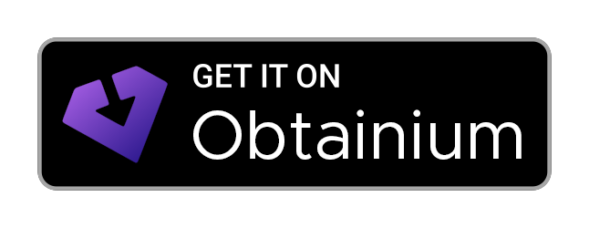
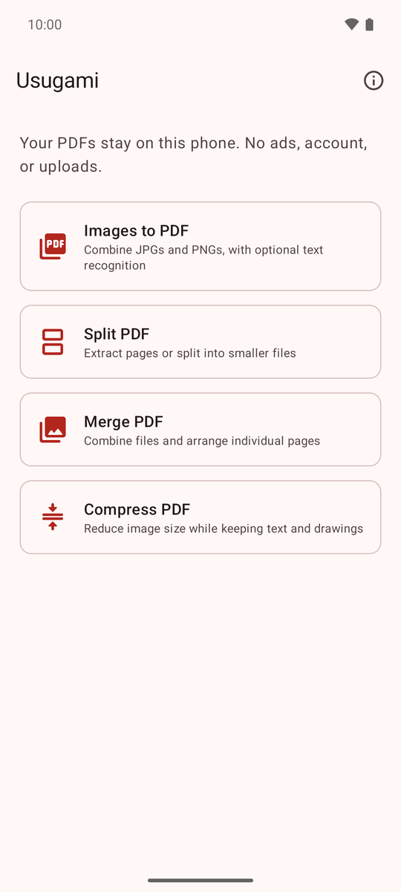
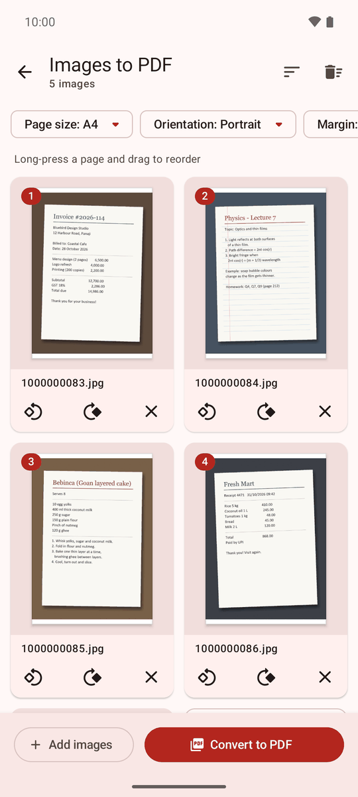
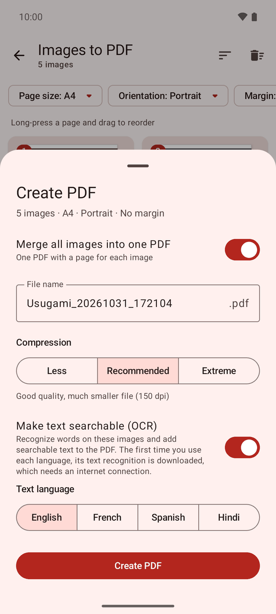
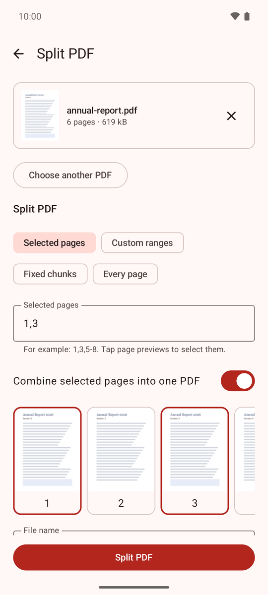

# Usugami

**Turn photos into PDFs, and split, merge and compress PDFs, right on your Android phone. No ads,
no tracking, no account, no uploads.**

*Usugami* (薄紙, oo-soo-GAH-mee) is Japanese for "thin paper": a light app for making light PDFs.
It was called PDFer before version 1.2.0.

[](https://github.com/Nath-Goa/usugami/releases/latest)
[](LICENSE)
[](https://github.com/Nath-Goa/usugami/actions/workflows/ci.yml)


## Download

<a href="https://github.com/Nath-Goa/usugami/releases/latest/download/Usugami.apk"></a>
<a href="https://apps.obtainium.imranr.dev/redirect?r=obtainium://app/%7B%22id%22%3A%22io.github.nath_goa.usugami%22%2C%22url%22%3A%22https%3A%2F%2Fgithub.com%2FNath-Goa%2Fusugami%22%2C%22author%22%3A%22Nath-Goa%22%2C%22name%22%3A%22Usugami%22%2C%22additionalSettings%22%3A%22%7B%5C%22apkFilterRegEx%5C%22%3A%5C%22%5EUsugami%5C%5C%5C%5C.apk%24%5C%22%2C%5C%22autoApkFilterByArch%5C%22%3Afalse%2C%5C%22allowedSigningCertHashes%5C%22%3A%5C%226F%3A4F%3A23%3AAD%3AE0%3A3E%3A63%3A6A%3A7C%3AC3%3A68%3A16%3A89%3A44%3AD0%3ACC%3AFC%3A81%3A32%3AEF%3A34%3AC5%3A0B%3AC5%3AA4%3A6B%3A0C%3AA4%3ACB%3ABD%3AF4%3AED%5C%22%7D%22%7D"></a>

On your phone, tap **Get it on GitHub** to download **Usugami.apk** (about 2.4 MB), then follow the
[install steps](#install). Usugami comes in two editions; if you're not sure, take the first one.

| | **Usugami** (recommended) | **Usugami Offline** |
|---|---|---|
| Download | **[Usugami.apk](https://github.com/Nath-Goa/usugami/releases/latest/download/Usugami.apk)**, about 2.4 MB | **[Usugami-offline.apk](https://github.com/Nath-Goa/usugami/releases/latest/download/Usugami-offline.apk)**, about 22 MB |
| Images to PDF, split, merge, compress | Fully offline | Fully offline |
| Text recognition (OCR) for searchable PDFs | Runs on your phone through Google Play services. The first time you use it, Play services downloads Google's text-recognition model once. | Built into the app. Works with no internet, ever. |
| Internet needed | Only once, for that first text-recognition download | Never |
| Needs Google Play services | Only for text recognition | No |
| Works on | Android 8.0 or newer | Android 8.0 or newer, ARM phones (virtually all phones) |
| Pick it if | You're not sure | Your phone has no Google services (for example Huawei or a de-Googled phone), or you want no network use at all |

> [!NOTE]
> **About internet access:** Usugami itself has **no internet permission** and uploads nothing.
> The main **Usugami.apk** needs an internet connection **only for text recognition (OCR)**, and only
> once: the first time you use it, Google Play services downloads the recognition model.
> Everything else works offline. If you want text recognition built in, with no download ever,
> get **[Usugami-offline.apk](https://github.com/Nath-Goa/usugami/releases/latest/download/Usugami-offline.apk)** instead.

Both editions use the same package name and signing key, so you can switch at any time by
installing the other APK over the one you have. Your files and settings are kept. Every
[release](https://github.com/Nath-Goa/usugami/releases) also has a `SHA256SUMS.txt` file for
[checking your download](#verify-your-download).

## Screenshots

<p>
  
  
  
  
</p>

## Install

Usugami isn't on the Play Store, so you install the APK file yourself. It takes about a minute and
works on Android 8.0 or newer. Menu names differ a little between phones.

1. **Download.** On your phone, open this page and tap **[Usugami.apk](https://github.com/Nath-Goa/usugami/releases/latest/download/Usugami.apk)**
   (or **[Usugami-offline.apk](https://github.com/Nath-Goa/usugami/releases/latest/download/Usugami-offline.apk)**).
   Your browser may warn that *this type of file can harm your device*. That's a general warning
   for all APK files; tap **Download anyway**.
2. **Open the file.** When the download finishes, tap **Open**. If you missed it, open the
   **Files** app (or **My Files** on Samsung), go to **Downloads** and tap the APK.
3. **Allow installing.** The first time, Android says something like *For your security, your
   phone currently isn't allowed to install unknown apps from this source*. Tap **Settings**,
   turn on **Allow from this source**, then go back. This permission is per app: it only lets the
   app you used (for example Chrome or Files) install apps.
4. **Install.** Tap **Install**.
5. **Google Play Protect.** Play Protect may say it hasn't seen this app before, or that it
   doesn't recognize the developer, and offer to **Scan app**. Scanning is safe: it sends details
   about the app to Google and then lets you install. If Play Protect ever says Usugami is
   *harmful*, don't install it; please [open an issue](https://github.com/Nath-Goa/usugami/issues)
   instead.
6. **Optional:** turn **Allow from this source** off again for that app.

<details>
<summary><b>Where is "Install unknown apps"? (Samsung and other phones)</b></summary>

If you skipped step 3 or want to change it later:

- **Samsung:** Settings → Apps → ⋮ (top right) → Special access → Install unknown apps → pick your
  browser or My Files → Allow from this source.
- **Pixel and most other phones:** Settings → Apps → Special app access → Install unknown apps →
  pick the app → Allow from this source.
- Or search for "unknown apps" in the Settings app.

</details>

**Updating:** download the new APK and install it over the old one, the same way. Your files and
settings are kept. To get updates automatically, use [Obtainium](#automatic-updates-with-obtainium).

**Switching editions:** install the other APK over the one you have. No need to uninstall first.

**Had PDFer 1.0 or 1.1?** That was Usugami's old name. Those were private test builds with a
different package name, so Usugami installs as a separate app. Install Usugami, then uninstall the
old "PDFer".

## Features

**Images to PDF**

- Add JPG and PNG images from **Photos** (the system photo picker), **Files**, or by **sharing**
  them to Usugami from another app.
- Live page previews. Long-press and drag to **reorder**; **rotate**, **remove**, or **sort** by
  name or reverse the order.
- Page size **Fit** (same as the image), **A4**, **US Letter**, **US Legal**, **A3** or **A5**;
  orientation Auto, Portrait or Landscape; no margin, a small one or a big one.
- Make **one PDF** with every image, or **one PDF per image**.
- **Always compressed:** each image is sized for the space it fills on the page and saved as JPEG
  at **Less** (200 dpi), **Recommended** (150 dpi) or **Extreme** (100 dpi). If the original
  image is smaller, the original is kept.
- Phone photos come out the **right way up** (EXIF orientation).
- **Private by default:** location (GPS), camera details and other hidden metadata, and the video
  part of "motion photos", are removed from the images.
- Optional **searchable PDF** with text recognition (OCR) in **English** or **Hindi**. Hindi mode
  also keeps any English text.

**Split PDF**

- Pick pages by tapping previews or typing numbers like `1,3,5-8`.
- Enter separate ranges like `1-3;5;7-9`, split into chunks of a fixed size, or make one PDF per
  page.
- Combine the selection into one PDF, or save each part as its own file.

**Merge PDF**

- Add PDFs and put them in order, or sort them by name.
- Switch to page mode to reorder, rotate and remove individual pages before merging.

**Compress PDF**

- **Less**, **Recommended** or **Extreme**.
- Text stays selectable and drawings stay sharp; only images are reduced.
- Never makes a PDF bigger: if compressing can't save space, you keep the original. (Except
  for password-protected PDFs, which are always saved again without the password.)

**Everywhere**

- Password-protected PDFs can be opened with their password. The new files Usugami makes from them
  have no password, and Usugami tells you so.
- **Open**, **Share**, **Save to Downloads** (Android 10 and newer) or **Save as…** to any
  folder.
- Light and dark theme follow your phone.

## Privacy

- **No internet permission.** Android doesn't let Usugami connect to the internet, so it can't
  upload your files or send anything about you.
- **No ads, no analytics, no tracking, no accounts, no in-app purchases.**
- **Only the files you pick.** Usugami asks for no permissions; Android gives it access to just the
  images and PDFs you choose or share.
- **Temporary copies are cleaned up.** While you work, copies live in Usugami's private cache and
  are deleted automatically.
- **Standard edition and Google Play services:** text recognition runs on your phone. The first
  time, Google Play services (a separate Google app) downloads the model. Per
  [Google's ML Kit data disclosure](https://developers.google.com/ml-kit/android-data-disclosure),
  Play services may collect diagnostics and usage metrics about the ML Kit feature. Your images
  and the recognized text never leave your phone. Usugami also removes ML Kit's own metrics
  uploader from the app.
- **Usugami Offline** makes no network connections at all.

Read the full [privacy policy](PRIVACY.md). It's also inside the app.

## Verify your download

You don't have to do this, but you can check that an APK really comes from this project. The
signing certificate is what matters: Android only installs updates signed with the same
certificate, and only the developer has the key.

| | |
|---|---|
| Package name | `io.github.nath_goa.usugami` |
| Signing certificate SHA-256 | `6F:4F:23:AD:E0:3E:63:6A:7C:C3:68:16:89:44:D0:CC:FC:81:32:EF:34:C5:0B:C5:A4:6B:0C:A4:CB:BD:F4:ED` |

- **On your phone:** install [AppVerifier](https://github.com/soupslurpr/AppVerifier), then paste
  these two lines into it after installing Usugami:

  ```text
  io.github.nath_goa.usugami
  6F:4F:23:AD:E0:3E:63:6A:7C:C3:68:16:89:44:D0:CC:FC:81:32:EF:34:C5:0B:C5:A4:6B:0C:A4:CB:BD:F4:ED
  ```

<details>
<summary><b>On a computer: apksigner, checksums and build provenance</b></summary>

**Signing certificate** with `apksigner` from the Android SDK build-tools:

```sh
apksigner verify --print-certs Usugami.apk
```

The `certificate SHA-256 digest` line must read
`6f4f23ade03e636a7cc368168944d0ccfc8132ef34c50bc5a46b0ca4cbbdf4ed`. (`keytool -printcert -jarfile`
doesn't work here: Usugami uses the newer APK signature schemes, which keytool can't read.)

**Checksums:** download `SHA256SUMS.txt` from the same release, put it next to the APKs and run:

```sh
sha256sum -c SHA256SUMS.txt                     # Linux
shasum -a 256 -c SHA256SUMS.txt                 # macOS
Get-FileHash Usugami.apk -Algorithm SHA256        # Windows PowerShell: compare with the file
```

GitHub also shows each file's SHA-256 next to it on the release page.

**Build provenance:** release APKs are built from this repository's source by the
[release workflow](.github/workflows/release.yml) on GitHub Actions, which publishes a signed
build-provenance attestation for each one. Check it with the [GitHub CLI](https://cli.github.com/):

```sh
gh attestation verify Usugami.apk --repo Nath-Goa/usugami
```

</details>

## Automatic updates with Obtainium

[Obtainium](https://github.com/ImranR98/Obtainium) is a free app that installs and updates apps
straight from their GitHub releases. These links add Usugami to Obtainium with the right file and
the signing certificate already set, so Obtainium refuses any APK that wasn't signed with Usugami's
key:

- [Add **Usugami** to Obtainium](https://apps.obtainium.imranr.dev/redirect?r=obtainium://app/%7B%22id%22%3A%22io.github.nath_goa.usugami%22%2C%22url%22%3A%22https%3A%2F%2Fgithub.com%2FNath-Goa%2Fusugami%22%2C%22author%22%3A%22Nath-Goa%22%2C%22name%22%3A%22Usugami%22%2C%22additionalSettings%22%3A%22%7B%5C%22apkFilterRegEx%5C%22%3A%5C%22%5EUsugami%5C%5C%5C%5C.apk%24%5C%22%2C%5C%22autoApkFilterByArch%5C%22%3Afalse%2C%5C%22allowedSigningCertHashes%5C%22%3A%5C%226F%3A4F%3A23%3AAD%3AE0%3A3E%3A63%3A6A%3A7C%3AC3%3A68%3A16%3A89%3A44%3AD0%3ACC%3AFC%3A81%3A32%3AEF%3A34%3AC5%3A0B%3AC5%3AA4%3A6B%3A0C%3AA4%3ACB%3ABD%3AF4%3AED%5C%22%7D%22%7D) (standard edition)
- [Add **Usugami Offline** to Obtainium](https://apps.obtainium.imranr.dev/redirect?r=obtainium://app/%7B%22id%22%3A%22io.github.nath_goa.usugami%22%2C%22url%22%3A%22https%3A%2F%2Fgithub.com%2FNath-Goa%2Fusugami%22%2C%22author%22%3A%22Nath-Goa%22%2C%22name%22%3A%22Usugami%20Offline%22%2C%22additionalSettings%22%3A%22%7B%5C%22apkFilterRegEx%5C%22%3A%5C%22%5EUsugami-offline%5C%5C%5C%5C.apk%24%5C%22%2C%5C%22autoApkFilterByArch%5C%22%3Afalse%2C%5C%22allowedSigningCertHashes%5C%22%3A%5C%226F%3A4F%3A23%3AAD%3AE0%3A3E%3A63%3A6A%3A7C%3AC3%3A68%3A16%3A89%3A44%3AD0%3ACC%3AFC%3A81%3A32%3AEF%3A34%3AC5%3A0B%3AC5%3AA4%3A6B%3A0C%3AA4%3ACB%3ABD%3AF4%3AED%5C%22%7D%22%7D)

Open the link on your phone with Obtainium installed, and confirm. Add only one of the two: both
editions share a package name, so a phone has one or the other.

On Android 8.0 and 8.1, Obtainium can't read signing certificates, so it refuses to install an
app that has a certificate set. On those versions, add Usugami by hand (below) and leave the
certificate field empty.

<details>
<summary><b>Adding it by hand</b></summary>

In Obtainium, tap **Add app**, enter `https://github.com/Nath-Goa/usugami` as the app source URL,
and set:

- **Filter links by regex:** `^Usugami\.apk$` (or `^Usugami-offline\.apk$` for the offline
  edition)
- **Expected signing certificate hashes:** the SHA-256 fingerprint from
  [Verify your download](#verify-your-download) (leave empty on Android 8.0 and 8.1)

Setting names can differ slightly between Obtainium versions.

</details>

## Questions and troubleshooting

<details>
<summary><b>"App not installed" or "the package conflicts with an existing package"</b></summary>

- **A Usugami from somewhere else is installed.** Android only updates an app with an APK signed by
  the same key. If you got Usugami from another site, uninstall it first (save any PDFs you need to
  Downloads before you do), then install the APK from this page.
- **You're installing an older version** over a newer one. Android doesn't allow that; download
  the [latest release](https://github.com/Nath-Goa/usugami/releases/latest).
- **The download is incomplete or the phone is low on storage.** Free some space, download the APK
  again and try once more.
- The old PDFer 1.0 and 1.1 test builds don't conflict: they have a different package name and
  install side by side.

</details>

<details>
<summary><b>My phone doesn't have Google Play services</b></summary>

For example Huawei phones, or phones running LineageOS or /e/OS without Google apps. Images to
PDF, split, merge and compress all work in either edition. Text recognition in the standard
edition needs Google Play services; without it, Usugami tells you that text recognition isn't
available, and you can still create the PDF with OCR turned off.

For text recognition on such a phone, install
**[Usugami-offline.apk](https://github.com/Nath-Goa/usugami/releases/latest/download/Usugami-offline.apk)**
over your current Usugami: it has text recognition built in.

</details>

<details>
<summary><b>Text recognition is stuck downloading, or I have no internet</b></summary>

In the standard edition, the first text recognition needs Google Play services to download the
model once. If it doesn't finish:

- Check that you have a working Wi-Fi or mobile data connection.
- Make sure the phone has some free storage.
- Update Google Play services: open the Play Store, search for "Google Play services" and update
  it if you can.
- Try again in a few minutes. Your images stay in Usugami, and you can also create the PDF with OCR
  turned off.

If you often have no internet, or want no download at all, install
**[Usugami Offline](https://github.com/Nath-Goa/usugami/releases/latest/download/Usugami-offline.apk)**
over your current Usugami.

</details>

<details>
<summary><b>Recognizing Hindi text</b></summary>

When you create the PDF, turn on **Make text searchable (OCR)** and choose **Hindi** under the text
language. Hindi mode reads Devanagari and also keeps English words and numbers, so mixed text works.
English and Hindi are the only languages for now.

</details>

<details>
<summary><b>Where are my PDFs saved?</b></summary>

Nowhere until you choose. When a PDF is ready you can:

- **Save to Downloads** (Android 10 and newer): it appears in the Downloads folder of your Files app.
- **Save as…**: choose any folder, on any Android version.
- **Share** it to another app, or **Open** it in a PDF viewer.

Until you save or share it, the PDF stays in Usugami's private storage and is cleaned up
automatically.

</details>

<details>
<summary><b>How much storage does Usugami use?</b></summary>

The app takes about 2.4 MB (standard) or 22 MB (offline) to download. While you work, Usugami keeps
temporary copies of your files in its cache and deletes them automatically; you can also clear it
in Settings → Apps → Usugami → Storage. In the standard edition, the text-recognition model is
stored and managed by Google Play services, not by Usugami.

</details>

<details>
<summary><b>Will Android's new developer verification stop me installing Usugami?</b></summary>

Google has announced that Android will check that apps come from verified developers. As of
October 2026 these checks don't apply to apps downloaded from GitHub, so you can install Usugami as
described above. Google has said it plans to extend the checks to all countries in 2027. If that
changes how you install Usugami, this page will be updated.

</details>

<details>
<summary><b>Is it really free? Can I use it at work?</b></summary>

Yes. Usugami is free and open source, with no ads or paid features. You can use it for any purpose,
including commercial work. See [License](#license).

</details>

## Build from source

<details>
<summary><b>Requirements, commands and signing</b></summary>

You need JDK 17 or newer (Android Studio's bundled JBR works; CI uses Temurin 21) and the Android
SDK, with its location in `local.properties` (`sdk.dir=...`; Android Studio creates it).

```sh
./gradlew :core:test                    # PDF engine unit tests (JVM)
./gradlew :app:assembleStandardRelease  # Usugami
./gradlew :app:assembleOfflineRelease   # Usugami Offline
./gradlew :app:connectedStandardDebugAndroidTest  # device tests (phone or emulator)
./gradlew :app:connectedOfflineDebugAndroidTest
```

The APKs end up in:

- `app/build/outputs/apk/standard/release/app-standard-release.apk`
- `app/build/outputs/apk/offline/release/app-offline-release.apk`

The two editions are product flavors (`standard` and `offline`, dimension `ocr`) with the same
application ID. Without a signing key, release builds come out unsigned
(`app-<flavor>-release-unsigned.apk`). To sign them, set these environment variables:

```sh
USUGAMI_KEYSTORE_PATH=/path/to/release.keystore
USUGAMI_KEYSTORE_PASSWORD=...
USUGAMI_KEY_ALIAS=...
USUGAMI_KEY_PASSWORD=...
```

or create a `keystore.properties` file in the project root (it is git-ignored):

```properties
storeFile=/path/to/release.keystore
storePassword=...
keyAlias=...
keyPassword=...
```

APKs you sign with your own key can't update the official ones, and the other way round.
[docs/TESTING.md](docs/TESTING.md) explains how Usugami is tested.

</details>

## Project structure

```text
app/                  Android app (Kotlin, Jetpack Compose, Material 3)
  src/main/           shared code: screens, PDF tools, OCR text layer, saving and sharing
  src/standard/       text recognition through Google Play services
  src/offline/        built-in text recognition
  src/androidTest/    device tests
core/                 plain-Kotlin PDF engine with JVM unit tests: PDF writer, page layout,
                      JPEG/PNG handling, metadata removal, compression sizing, page ranges
tools/                validate_pdfs.py (checks output with independent PDF tools),
                      make_ocr_font.py (builds the OCR font), google_notices.py
third_party/          license notices that Google ships in its libraries
docs/                 testing guide, badges, screenshots
.github/              CI and release workflows
```

PDF splitting, merging and compression use [PdfBox-Android](https://github.com/TomRoush/PdfBox-Android);
text recognition uses [Google ML Kit](https://developers.google.com/ml-kit/vision/text-recognition/v2).

## Contributing

Bug reports, ideas and pull requests are welcome; see [CONTRIBUTING.md](CONTRIBUTING.md). Usugami
won't accept ads, tracking or network features. To report a security problem privately, see
[SECURITY.md](SECURITY.md).

## License

Usugami is free software: you can redistribute it and/or modify it under the terms of the
[GNU General Public License](LICENSE), version 3 or (at your option) any later version.
Copyright (C) 2026 Nathan Kumtakar.

Because text recognition uses Google ML Kit, which isn't open source, the license includes an
[additional permission](LICENSE-EXCEPTION.md) (GPL section 7) that allows combining Usugami with
Google ML Kit and Google Play services libraries.

You may use Usugami for any purpose, including commercial use. If you share Usugami or a modified
version of it, the GPL applies: you must make the source code available under the same license.
Components by others are listed, with their licenses, in
[THIRD_PARTY_NOTICES.md](THIRD_PARTY_NOTICES.md).

## Acknowledgements

- [PdfBox-Android](https://github.com/TomRoush/PdfBox-Android) by Tom Roush and contributors, a
  port of [Apache PDFBox](https://pdfbox.apache.org/), for reading and writing PDFs.
- [Google ML Kit](https://developers.google.com/ml-kit) for on-device text recognition.
- [Noto Sans and Noto Sans Devanagari](https://fonts.google.com/noto), from which Usugami's
  invisible OCR font is made.
- [Reorderable](https://github.com/Calvin-LL/Reorderable) by Calvin Liang, for drag-to-reorder.
- [Jetpack Compose](https://developer.android.com/compose) and the AndroidX libraries.
- Badge artwork: "Get it on GitHub" from [Kunzisoft/Github-badge](https://github.com/Kunzisoft/Github-badge)
  (CC BY-SA 3.0, based on the F-Droid badge by flocke), and the Obtainium badge from
  [Obtainium](https://github.com/ImranR98/Obtainium) (GPL-3.0). See [docs/badges](docs/badges/README.md).

Usugami is not affiliated with or endorsed by Google, GitHub or Obtainium.
